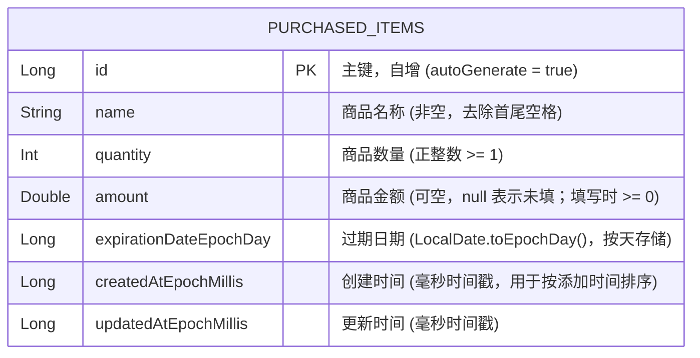

# MyList - 已购商品与保质期管理 Android 应用

MyList 是一款基于 **Kotlin + Jetpack Compose + Room** 开发的轻量级 Android 应用，用于记录已购商品的名称、数量、金额与过期日期，提供临期/过期高亮提醒、快捷数量加减、搜索、多维排序、防误删撤销以及顶部统计概览功能。

---

## 1. 本地环境配置步骤

### 环境要求
- **操作系统**：Windows 10/11 (终端使用 PowerShell 5.1/7+)
- **JDK 版本**：JDK 17 或更高版本
- **Android SDK**：
  - `compileSdk`：35 (或 34)
  - `minSdk`：26 (Android 8.0，支持 `java.time.LocalDate`)
  - `targetSdk`：35 (或 34)
- **构建工具**：Gradle Wrapper (`.\gradlew.bat`) / Android CLI (`android`)

### 构建与运行步骤（PowerShell）

1. **克隆仓库**
   ```powershell
   git clone https://github.com/eng-dotcom/mylist.git
   cd mylist
   ```

2. **配置 Android SDK 路径**
   确保环境变量 `$env:ANDROID_HOME` 已设置，或在项目根目录创建 `local.properties`：
   ```properties
   sdk.dir=C:\\Users\\<YourUsername>\\AppData\\Local\\Android\\Sdk
   ```

3. **运行单元测试（TDD 自检）**
   ```powershell
   .\gradlew.bat testDebugUnitTest
   ```

4. **构建 Debug APK**
   ```powershell
   .\gradlew.bat assembleDebug
   ```

5. **安装并运行到模拟器/真机**
   ```powershell
   .\gradlew.bat installDebug
   ```

---

## 2. 当前数据库的表结构图

本项目使用 **Room (SQLite)** 进行本地数据持久化，核心数据表为 `purchased_items`。



### 字段说明
| 字段名 | 类型 | 必填 | 约束与说明 |
| :--- | :--- | :---: | :--- |
| `id` | `Long` | 是 | 主键，自动递增 |
| `name` | `String` | 是 | 商品名称，非空字符串 |
| `quantity` | `Int` | 是 | 商品数量，纯正整数（`>= 1`） |
| `amount` | `Double?` | 否 | 商品金额，选填（可为 `null`）；填写时 `>= 0` |
| `expirationDateEpochDay` | `Long` | 是 | 过期日期，使用 `LocalDate.toEpochDay()` 存储 |
| `createdAtEpochMillis` | `Long` | 是 | 记录创建时间戳（毫秒） |
| `updatedAtEpochMillis` | `Long` | 是 | 记录最后修改时间戳（毫秒） |

---

## 3. 后端/数据层 API 接口清单

由于本应用为离线优先的本地 Android 应用，后端数据服务由 **Room DAO (`PurchasedItemDao`)**、**仓库层 (`PurchasedItemRepository`)** 与 **领域逻辑服务 (`ItemDomainService` / `PurchasedItemViewModel`)** 提供。

### 3.1 Room DAO 接口 (`PurchasedItemDao`)
| 方法签名 | 功能描述 | 返回类型 |
| :--- | :--- | :--- |
| `observeAllItems()` | 响应式监听全部已购商品列表 | `Flow<List<PurchasedItemEntity>>` |
| `getItemById(id: Long)` | 根据主键 ID 查询单个商品详情 | `PurchasedItemEntity?` |
| `insertItem(item: PurchasedItemEntity)` | 新增或恢复（Undo）商品记录 | `Long` (新记录 ID) |
| `updateItem(item: PurchasedItemEntity)` | 更新已有商品的名称、数量、金额、过期日期 | `Int` (受影响行数) |
| `deleteItem(item: PurchasedItemEntity)` | 删除指定商品记录 | `Int` (受影响行数) |
| `deleteItemById(id: Long)` | 根据 ID 删除指定商品记录 | `Int` (受影响行数) |

### 3.2 仓库层与领域业务接口 (`PurchasedItemRepository`)
| 接口名称 | 参数说明 | 校验/业务逻辑 | 返回类型 |
| :--- | :--- | :--- | :--- |
| `getAllItemsStream()` | 无 | 返回实时更新的领域模型 `PurchasedItem` 列表 | `Flow<List<PurchasedItem>>` |
| `addItem(name, quantity, amount, expirationDate)` | `name: String`, `quantity: Int`, `amount: Double?`, `expirationDate: LocalDate` | 校验名称非空、`quantity >= 1`、`amount == null \|\| amount >= 0` | `Result<Long>` |
| `updateItem(item: PurchasedItem)` | `item: PurchasedItem` | 校验修改后的字段合法性并更新 `updatedAt` | `Result<Unit>` |
| `adjustQuantity(id: Long, delta: Int)` | `id: Long`, `delta: Int` (`+1` 或 `-1`) | 快捷加减数量；若调整后 `quantity < 1` 则返回边界提示或拒绝直接减为负数 | `Result<PurchasedItem>` |
| `deleteItem(item: PurchasedItem)` | `item: PurchasedItem` | 删除商品并缓存最后删除项以支持 Undo 恢复 | `Result<Unit>` |
| `restoreItem(item: PurchasedItem)` | `item: PurchasedItem` | 撤销删除（原 ID 重新插入数据库） | `Result<Unit>` |

### 3.3 视图模型查询、筛选与统计接口 (`PurchasedItemViewModel` / `ItemQueryEngine`)
| 接口/纯函数名称 | 参数说明 | 功能描述 |
| :--- | :--- | :--- |
| `computeExpirationStatus(expirationDate, today)` | `expirationDate: LocalDate`, `today: LocalDate` | 计算商品状态：`EXPIRED` (<0天)、`EXPIRING_SOON` (0~7天)、`NORMAL` (>7天) 及相差天数 |
| `filterAndSortItems(items, query, statusFilter, sortOption, today)` | 列表、搜索词、状态过滤枚举、排序枚举、当前日期 | 执行大小写不敏感的名称搜索、状态过滤（全部/临期/已过期/正常）及多维排序 |
| `computeSummaryStats(items, today)` | `items: List<PurchasedItem>`, `today: LocalDate` | 计算顶部统计卡片数据：总条目数、商品总件数、临期数、已过期数、已填金额总计 |
